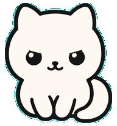
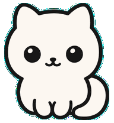

# Agent Pet

**给 Codex 养只桌宠：看进度、收提醒，用微信接着干活。**

Agent Pet 是一款 Windows 桌面宠物助手。Codex 工作时，宠物陪你看进度；任务完成或需要你确认时，及时提醒；离开电脑后，也能通过微信查看结果、继续下指令。

[下载安装](https://github.com/wy1003/agent-pet/releases) · [使用指南](docs/USAGE.md) · [微信指令](docs/WEIXIN_REMOTE_CONTROL.md)

[](https://github.com/wy1003/agent-pet/actions/workflows/ci.yml)
[](LICENSE)

<table>
  <tr>
    <td align="center"><br><b>Codex 正在工作</b></td>
    <td align="center"><br><b>等你确认</b></td>
    <td align="center"><br><b>任务完成啦</b></td>
  </tr>
</table>

## 它能帮你做什么

- **不用一直盯着 Codex**：桌宠显示任务状态，点击即可查看多个项目的任务。
- **做完了叫你一声**：支持桌面通知、语音播报和微信提醒。
- **离开电脑也能继续**：在微信中向原会话追加要求，或在指定项目新建任务，结果返回微信。
- **换成你喜欢的宠物**：拖入宠物 ZIP 即可切换，支持 Codex 精灵表和状态 GIF。

## 开始使用

1. 从 [Releases](https://github.com/wy1003/agent-pet/releases) 下载 **Windows x64 安装版**（`Setup`）或免安装版（`Portable`）。
2. 打开 Codex 和 Agent Pet，桌宠会自动跟踪本机任务。
3. 点击宠物查看任务，在设置中开启需要的通知。想用微信续问，在“远程通知”中扫码连接微信，并开启默认关闭的“指令操作”。

### 微信里继续一个任务

先发送 `/sessions` 查看会话编号，再发送：

```text
/S0001 帮我给刚才的功能补上测试
```

**微信发出要求 → Codex 原会话继续执行 → 微信收到结果。**

将 `S0001` 换成自己的会话编号；电脑需保持联网并运行 Agent Pet。[查看完整连接步骤与指令](docs/WEIXIN_REMOTE_CONTROL.md)

## 更多

- [使用指南](docs/USAGE.md)：任务收件箱、语音、自定义宠物、隐私与源码运行。
- [微信指令指南](docs/WEIXIN_REMOTE_CONTROL.md)：连接、续问、新任务、状态查询和故障处理。
- [反馈问题](https://github.com/wy1003/agent-pet/issues) · QQ 交流群：`650561994`

当前支持 Codex Desktop，兼容 Codex SDK / CC GUI 任务。本文对应 `main` 源码，安装包功能以版本发布说明为准。开源协议：[MIT](LICENSE)。
